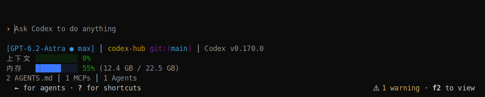
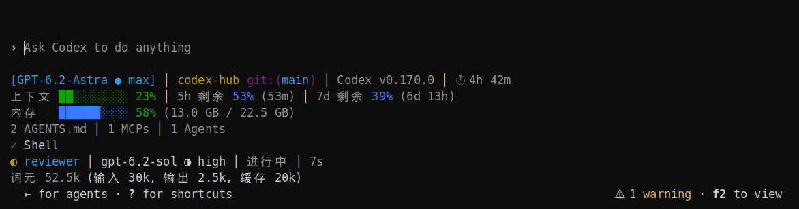

# Codex Hub

English · [简体中文](README_zh.md)

Codex Hub adds a multi-line HUD directly below the Codex CLI input box. Follow the installation steps for your shell, then run your usual command.

```sh
codex
```



*Captured from Codex CLI 0.170.0 in an isolated WSL session.*

Activity rows appear as Codex records them. The HUD runs in a terminal with Codex CLI. The Codex desktop app and IDE extension have their own displays.

## Install online

Put Node.js 22 or later and Codex CLI on `PATH`. On Linux, macOS, and WSL, the installer also uses Bash, `curl`, and `unzip`. On Windows, use PowerShell 5.1 or later. The GitHub release bundles the terminal dependencies for x64 and arm64.

### Bash or Zsh (Linux, macOS, WSL)

```bash
(installer=$(curl -fsSL https://raw.githubusercontent.com/yuwenlong/codex-hub/main/scripts/install.sh) && [ -n "$installer" ] &&
  command env "CODEX_HOME=${CODEX_HOME-}" "CODEX_HUB_SHELL=${CODEX_HUB_SHELL:-${ZSH_VERSION:+zsh}${BASH_VERSION:+bash}}" "ZDOTDIR=${ZDOTDIR-}" bash -c "$installer") &&
  case $- in *i*) . "${CODEX_HOME:-$HOME/.codex}/codex-hub/scripts/activate.sh" ;; esac
```

This command loads Codex Hub in the current interactive shell, so you can run `codex` in the same terminal. See [diagnostics](#diagnostics-and-explicit-launcher) if an existing shell still shows the single-line footer.

### Windows PowerShell

```powershell
irm https://raw.githubusercontent.com/yuwenlong/codex-hub/main/scripts/install.ps1 | iex
```

Open a new interactive PowerShell window after installation and run `codex`.

### Windows CMD

```cmd
powershell -NoProfile -Command "irm https://raw.githubusercontent.com/yuwenlong/codex-hub/main/scripts/install.ps1 | iex"
```

CMD can run the installer. Open a new interactive PowerShell session for automatic `codex` activation, or run the explicit launcher from CMD.

```cmd
set "CODEX_HUB_CLI=%USERPROFILE%\.codex\codex-hub\bin\codex-hub.mjs"
if defined CODEX_HOME set "CODEX_HUB_CLI=%CODEX_HOME%\codex-hub\bin\codex-hub.mjs"
node "%CODEX_HUB_CLI%" launch --
```

The installer downloads `codex-hub.zip` from the latest published GitHub release and installs the runtime under `$CODEX_HOME/codex-hub`, which defaults to `~/.codex/codex-hub`. Export a custom `CODEX_HOME` before running standalone commands such as the uninstaller, using the same value for installation, launch, and removal.

The installer retries temporary connection errors and HTTP failures such as 429 or 503 while downloading the release. If the initial script download fails, run the same command again.

The Bash and Zsh command configures the shell that runs it. On Windows the installer uses the current user's all-hosts PowerShell profile. Existing `codex` aliases and functions retain priority. Run the same installation command again to upgrade. For a first install with manual startup, export `CODEX_HUB_SHELL=none` and use the [explicit launcher](#diagnostics-and-explicit-launcher). If you reinstall with `CODEX_HUB_SHELL=none` after loading Codex Hub, open a new terminal or run `CODEX_HUB_BYPASS=1 codex` in the current Bash or Zsh.

If you upgrade in a terminal that already loaded an earlier Codex Hub launcher and use a custom configuration directory, run `export CODEX_HOME` before starting `codex` there.

## Use the HUD

Run `codex` for a new session. Run `codex resume` to pick a session, or pass its ID to resume it directly. The launcher starts the Codex executable on `PATH` and applies display overrides to that invocation only. `codex exec`, `codex app-server`, help, and commands without a terminal use the original CLI behavior. An explicit `--no-alt-screen`, `--remote`, or custom terminal title or status line override also uses the original CLI.

Codex CLI 0.170.0 uses its embedded app-server for sessions with command-line display overrides. To use your usual shared background server settings for a session, run `CODEX_HUB_BYPASS=1 codex` in Bash or Zsh, or run `& (Get-Command codex -CommandType Application | Select-Object -First 1).Source` in PowerShell.

The compact rows show the current model and reasoning effort, workspace and Git branch, Codex version, context usage, and system memory. Terminals with OSC 8 support can open the local directory from the workspace name. Memory reflects the environment where Codex runs, including WSL. The token row appears when usage is recorded and breaks out uncached input, output, and cached input where available. Once a completed text response in the current turn has matching usage and timing records, the row shows its approximate output rate in `tok/s` using the text's duration and excluding reasoning tokens. Codex may report estimated costs for eligible Enterprise sessions.

For sessions using the official OpenAI provider, the HUD displays the quota groups reported by the local Codex app-server. A single group uses the compact quota slots beside context usage. Multiple groups appear below activity with named meters that fill by remaining quota and change color based on usage. Countdown values appear when reset times are available. When account quota data is unavailable, the HUD uses available values from the session or native footer. The screenshot was captured in the WSL CLI using a controlled response in Codex's official quota format. [Grouped quota example](docs/hud-quotas.png)



*Captured from the same Codex CLI using a controlled local session record for the subagent events and 23% context value.*

- The latest turn supplies tool activity and MCP calls. MCP servers are listed once and failures are marked. The Skills row shows selections explicitly recorded by Codex.
- The HUD puts running subagents first and shows up to three total. It reserves up to two of those slots for agents that finished within the last 60 seconds. Names, models, effort, and elapsed times come from recorded agent events when available. Each row also shows a short task from a recorded assignment or recent activity from the child session when available.
- Task progress follows the current `update_plan` counts from the native footer. The environment row counts effective `AGENTS.md` files, enabled MCP servers and hooks, and inline `[agents.<name>]` roles available through the local app-server. A named CLI profile can make environment counts unavailable. Codex Hub omits missing fields and empty activity rows.

The layout draws on Claude HUD and agy-hud's alignment and expanded default. [Claude HUD](https://github.com/jarrodwatts/claude-hud) · [agy-hud alignment](https://github.com/yuwenlong/agy-hud/commit/3a585b5376f42685d8a21f83342ceb34f0f76d10) · [agy-hud expanded default](https://github.com/yuwenlong/agy-hud/commit/54c25a60950bb0717910492d37af0fa53384b3dc)

## Diagnostics and explicit launcher

The explicit launcher works without shell activation. `doctor` checks the effective status line setting. `status` prints one activity snapshot, `watch` polls every 2.5 seconds, and `preview` shows sample HUD data. Codex's original display remains available when a dialog is open or the terminal is too narrow for an embedded HUD.

### Bash or Zsh

If you still see a single `model · project · branch ...` line after installing or reopening Codex, run `/exit` in Codex and copy `SESSION_ID` from the resume command that Codex prints. With v0.2.2 or later, run the following in the existing terminal when it matches the configured shell and startup file. Use the session ID you just copied.

```bash
if [ -n "${CODEX_HOME-}" ]; then export CODEX_HOME; fi
. "${CODEX_HOME:-$HOME/.codex}/codex-hub/scripts/activate.sh" && codex resume SESSION_ID
```

Resume with the explicit launcher if you have an older installation, your shell differs from the configured shell, a custom `codex` alias or function takes precedence, or Codex still shows a single line after activation.

```bash
command env "CODEX_HOME=${CODEX_HOME:-$HOME/.codex}" \
  node "${CODEX_HOME:-$HOME/.codex}/codex-hub/bin/codex-hub.mjs" launch -- resume SESSION_ID
```

```bash
codex_hub_cli="${CODEX_HOME:-$HOME/.codex}/codex-hub/bin/codex-hub.mjs"
node "$codex_hub_cli" launch --
node "$codex_hub_cli" doctor
node "$codex_hub_cli" status
node "$codex_hub_cli" watch --cwd "/path/to/my project"
node "$codex_hub_cli" preview
```

### PowerShell

```powershell
$codexHome = if ($env:CODEX_HOME) { $env:CODEX_HOME } else { Join-Path $HOME '.codex' }
$codexHubCli = Join-Path $codexHome 'codex-hub\bin\codex-hub.mjs'
node "$codexHubCli" launch --
node "$codexHubCli" doctor
node "$codexHubCli" status
node "$codexHubCli" watch --cwd 'C:\Projects\My Project'
node "$codexHubCli" preview
```

`status` and `watch` accept `--thread SESSION_ID`. Without `--thread` or `--cwd`, they use `CODEX_THREAD_ID` when set and otherwise look up the most recent main session in the current directory. Press `Ctrl+C` to stop `watch`. Redirecting it to a file writes one snapshot.

## Uninstall online

### Bash or Zsh (Linux, macOS, WSL)

```bash
(uninstaller=$(curl -fsSL https://raw.githubusercontent.com/yuwenlong/codex-hub/main/uninstall.sh) && [ -n "$uninstaller" ] && bash -c "$uninstaller")
```

### Windows PowerShell

```powershell
irm https://raw.githubusercontent.com/yuwenlong/codex-hub/main/uninstall.ps1 | iex
```

### Windows CMD

```cmd
powershell -NoProfile -Command "irm https://raw.githubusercontent.com/yuwenlong/codex-hub/main/uninstall.ps1 | iex"
```

The uninstaller removes the managed launcher and installation. It restores a saved status line when Codex Hub still owns the setting and keeps any later edits. Open a new shell when finished. To recover from a force-stopped operation that reports a lock, confirm the installer has exited, remove the empty lock directory named in the error, and rerun the command.

The uninstaller uses a complete local installation when available. If it needs to download the release to recover an incomplete installation, it retries temporary failures.

## Install manually from ZIP

Extract `codex-hub.zip` and open the extracted `codex-hub` directory. Use the same `CODEX_HOME` as the online installer. [Download codex-hub.zip](https://github.com/yuwenlong/codex-hub/releases/latest/download/codex-hub.zip)

### Bash or Zsh

```bash
node ./scripts/manage.mjs install
```

### PowerShell

```powershell
$env:CODEX_HUB_PS_PROFILE = $PROFILE.CurrentUserAllHosts
node .\scripts\manage.mjs install
```

## Develop and test

Install the dependencies in this checkout with `npm ci --ignore-scripts`. Then launch Codex with the current code in one command, from the checkout in an interactive terminal.

```sh
node ./bin/codex-hub.mjs launch --
```

This command starts your installed Codex CLI from the checkout and refreshes activity automatically. Rerun it after editing the renderer to see the new code without publishing to npm.

```sh
npm test
npm run test:integration
```

The integration tests use Codex CLI 0.170.0 and temporary configuration and working directories with spaces and Chinese characters. [Tests workflow](https://github.com/yuwenlong/codex-hub/actions/workflows/test.yml)

## Star History

<a href="https://www.star-history.com/?repos=yuwenlong%2Fcodex-hub&type=date&legend=top-left">
 <picture>
   <source media="(prefers-color-scheme: dark)" srcset="https://api.star-history.com/chart?repos=yuwenlong/codex-hub&type=date&theme=dark&legend=top-left" />
   <source media="(prefers-color-scheme: light)" srcset="https://api.star-history.com/chart?repos=yuwenlong/codex-hub&type=date&legend=top-left" />
   
 </picture>
</a>

[Codex CLI docs](https://learn.chatgpt.com/docs/codex/cli) · [MIT License](LICENSE)
