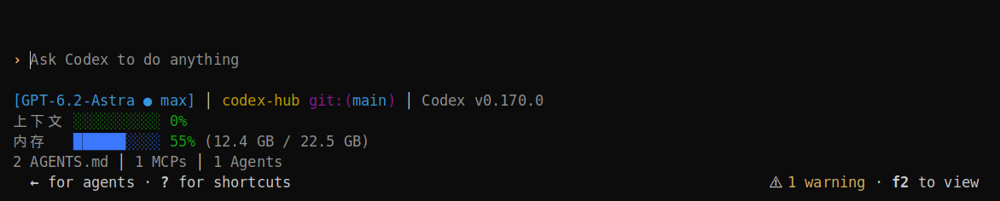
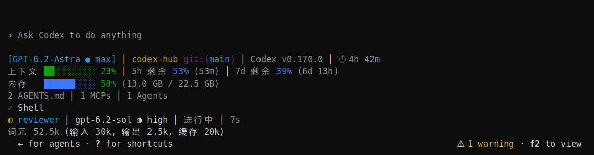

# Codex HUD

[English](README.md) · 简体中文

Codex HUD 在 Codex CLI 的输入框正下方显示多行 HUD。按下方说明安装并加载对应 shell 的启动入口，然后像平时一样运行下面的命令。

```sh
codex
```



*图为隔离 WSL 会话中实际运行的 Codex CLI 0.170.0。文中的三张截图均保留原始终端画面，工作区名已更正为 `codex-hud`。*

Codex 记录了活动后，相应的行才会出现。HUD 在终端里的 Codex CLI 中运行。Codex 桌面应用和 IDE 扩展使用各自的界面。

## 在线安装

请将 Node.js 22 或更新版本及 Codex CLI 放在 `PATH` 中。Linux、macOS 和 WSL 的安装器还使用 Bash、`curl` 和 `unzip`。Windows 请使用 PowerShell 5.1 或更新版本。GitHub 发行包自带 x64 和 arm64 的终端依赖。

从 Codex Hub 升级时，请先按[迁移步骤](#从-codex-hub-迁移)卸载旧版。

### Bash 或 Zsh（Linux、macOS、WSL）

```bash
bash <(curl -fsSL https://raw.githubusercontent.com/yuwenlong/codex-hud/main/scripts/install.sh)
```

安装器会自动配置当前 shell 的启动入口。安装后新开终端即可直接运行 `codex`，若要在当前已打开的终端立即启用，请运行 `. "${CODEX_HOME:-$HOME/.codex}/codex-hud/scripts/activate.sh"`。升级时重新运行上述短命令即可（若使用自定义 `CODEX_HOME`，请先执行 `export CODEX_HOME=...`）。已有终端仍显示原生单行时，可查看[排障步骤](#诊断与显式启动)。

### Windows PowerShell

```powershell
irm https://raw.githubusercontent.com/yuwenlong/codex-hud/main/scripts/install.ps1 | iex
```

安装结束后，新开一个交互式 PowerShell 窗口并运行 `codex`。

### Windows CMD

```cmd
powershell -NoProfile -Command "irm https://raw.githubusercontent.com/yuwenlong/codex-hud/main/scripts/install.ps1 | iex"
```

CMD 可以运行安装器。新开交互式 PowerShell 后，直接输入 `codex` 即可启动 HUD。继续使用 CMD 时，运行下面的显式启动命令。

```cmd
set "CODEX_HUD_CLI=%USERPROFILE%\.codex\codex-hud\bin\codex-hud.mjs"
if defined CODEX_HOME set "CODEX_HUD_CLI=%CODEX_HOME%\codex-hud\bin\codex-hud.mjs"
node "%CODEX_HUD_CLI%" launch --
```

安装器从 GitHub 最新正式发行版下载 `codex-hud.zip`，并将运行文件放在 `$CODEX_HOME/codex-hud`，默认为 `~/.codex/codex-hud`。若使用自定义 `CODEX_HOME`，请在运行安装器、卸载器等命令前导出该变量，安装、启动和卸载都使用同一个值。

下载发行包遇到临时连接故障或 HTTP 429、503 等响应时，安装器会自动重试。如果开头的脚本下载失败，重新运行同一条命令即可。

Bash 和 Zsh 的在线命令会为运行它的 shell 配置启动入口。Windows 使用当前用户的 PowerShell 全宿主配置文件。已有的 `codex` 别名和函数优先。重新运行同一条安装命令可以更新 Codex HUD。首次安装时若想手动启动，可导出 `CODEX_HUD_SHELL=none` 后安装，再使用[显式启动命令](#诊断与显式启动)。若当前终端已加载 Codex HUD，设置 `CODEX_HUD_SHELL=none` 并重装后可新开终端，或在当前 Bash 或 Zsh 运行 `CODEX_HUD_BYPASS=1 codex`。

更新后继续使用已经打开的终端时，若使用自定义配置目录，请先运行 `export CODEX_HOME`，再启动 `codex`。

## 从 Codex Hub 迁移

如果从未安装过 Codex Hub，可直接[安装 Codex HUD](#在线安装)。

先退出 Codex Hub 启动的 Codex 会话。迁移期间使用原来的 `CODEX_HOME`。如果用了自定义目录，请在 Bash 或 Zsh 中导出 `CODEX_HOME`，或在 PowerShell 中设定 `$env:CODEX_HOME`。如果该变量只在当前会话中生效，每次新开 shell 都要重新设置。

从 [GitHub v0.2.6 发行包](https://github.com/yuwenlong/codex-hud/releases/download/v0.2.6/codex-hub.zip)运行旧版卸载器。这适用于所有旧版本和不完整的安装。下方命令会先核对发行包的 SHA-256。

旧版卸载器会保留你另外放入旧运行目录的文件。旧预设仍生效时会还原状态栏备份，后来手动修改的值会保留。Codex HUD 应用预设前会备份迁移后的状态栏。其余 Codex 配置和会话仍保存在原目录。如果希望原生 Codex 继续显示自定义状态栏，可在安装后重新设定 `tui.status_line`。

### Bash 或 Zsh（Linux、macOS、WSL）

```bash
(
  if [ -n "${CODEX_HOME-}" ]; then export CODEX_HOME || exit 1; fi
  legacy_dir=$(mktemp -d "${TMPDIR:-/tmp}/codex-hub-uninstall.XXXXXXXX") || exit 1
  trap 'rm -rf -- "$legacy_dir"' EXIT
  archive="$legacy_dir/codex-hub.zip"
  curl -fsSL --proto-redir '=https' 'https://github.com/yuwenlong/codex-hud/releases/download/v0.2.6/codex-hub.zip' -o "$archive" || exit 1
  node -e '
    const archive = require("node:fs").readFileSync(process.argv[1]);
    const hash = require("node:crypto").createHash("sha256").update(archive).digest("hex");
    if (hash !== process.argv[2]) throw new Error("Codex Hub ZIP SHA-256 mismatch.");
  ' "$archive" '27827ac50e32e7752096e64ffb4133f0d2feb26c9481801c08147c46ffb613da' || exit 1
  unzip -q "$archive" -d "$legacy_dir" || exit 1
  node "$legacy_dir/codex-hub/scripts/manage.mjs" uninstall
)
```

### PowerShell（也适用于从 CMD 启动的用户）

```powershell
$legacyDir = Join-Path ([IO.Path]::GetTempPath()) ('codex-hub-uninstall-' + [guid]::NewGuid().ToString('N'))
[IO.Directory]::CreateDirectory($legacyDir) | Out-Null
try {
    $archive = Join-Path $legacyDir 'codex-hub.zip'
    Invoke-WebRequest -UseBasicParsing -Uri 'https://github.com/yuwenlong/codex-hud/releases/download/v0.2.6/codex-hub.zip' -OutFile $archive -ErrorAction Stop
    if ((Get-FileHash -LiteralPath $archive -Algorithm SHA256 -ErrorAction Stop).Hash -ne '27827ac50e32e7752096e64ffb4133f0d2feb26c9481801c08147c46ffb613da') {
        throw 'Codex Hub ZIP SHA-256 mismatch.'
    }
    Expand-Archive -LiteralPath $archive -DestinationPath $legacyDir -ErrorAction Stop
    node (Join-Path $legacyDir 'codex-hub\scripts\manage.mjs') uninstall
    if ($LASTEXITCODE -ne 0) { throw 'Codex Hub uninstall failed.' }
} finally {
    Remove-Item -LiteralPath $legacyDir -Recurse -Force
}
```

Codex Hub 和 Codex HUD 在修改同一个配置目录或启动文件时会使用同一套锁。如果被中断的操作留下了锁，请先确认所有新旧版安装和卸载进程都已退出。只删除报错指向的空锁目录。Bash 或 Zsh 可用 `rmdir`，PowerShell 可用 `[IO.Directory]::Delete('报错中的路径')`。旧版操作中断后重跑上述旧卸载器，若中断的是 Codex HUD 操作则重试原命令。

多个 `CODEX_HOME` 可以共用一个启动文件。如果还有旧启动块，先用提示中的标记 ID 和启动文件路径核对各旧配置目录的 `.codex-hub-shell.json`。用记录匹配的 `CODEX_HOME` 运行旧卸载器。若卸载器报告块被编辑过，先备份启动文件，将自定义内容移到块外，再按该目录的记录还原原启动块并重试卸载。

若要保留另一份旧安装，可为 Codex HUD 选用不同的 shell，或设置 `CODEX_HUD_SHELL=none` 后通过[显式入口](#诊断与显式启动)运行。只有确认某个块已无所属旧安装时，才在备份启动文件后手动清除该块。归属不明时请保留。

旧版卸载成功后关闭旧 shell。在新 shell 中将自己配置的 `CODEX_HUB_*` 选项改名为 `CODEX_HUD_*`，再按[在线安装步骤](#在线安装)安装 Codex HUD。装好后重新打开 shell 并运行 `codex`。

## 使用 HUD

输入 `codex` 新建会话。运行 `codex resume` 可选择会话，也可以直接指定会话 ID 恢复。启动器调用 `PATH` 上的 Codex，界面覆盖仅对本次启动生效。`codex exec`、`codex app-server`、帮助和没有终端的调用保持原生行为。显式指定 `--no-alt-screen`、`--remote`，或为本次启动自定义终端标题或状态栏时，也会走原生 CLI。

Codex CLI 0.170.0 对带命令行界面覆盖的会话使用内嵌的 app-server。若本次需要沿用原有的共享后台服务器设置，可在 Bash 或 Zsh 运行 `CODEX_HUD_BYPASS=1 codex`，或在 PowerShell 运行 `& (Get-Command codex -CommandType Application | Select-Object -First 1).Source`。

基础行显示当前模型与推理档位、工作区与 Git 分支、Codex 版本、上下文用量和系统内存。终端支持 OSC 8 时，可点击工作区名称打开本地目录。内存取自 Codex 所处环境，例如 WSL。记录用量后会出现词元行，有数据时区分非缓存输入、输出和缓存输入。当前回合的一条文本响应完成并记下可配对的用量和时段后，词元行会显示最近输出速率（`tok/s`），按文本输出耗时估算，扣除推理词元。符合条件的企业会话在 Codex 提供估算费用时会显示该值。

使用官方 OpenAI 提供方的会话会显示本机 Codex app-server 返回的额度分组。只有一组时，额度仍放在上下文旁边。多组额度显示在活动行下方，标出组名，进度条按剩余比例填充、按已用比例着色。有重置时间时显示倒计时。账户额度不可用时，使用会话记录或原生状态栏中已有的额度。截图来自 WSL 中实际运行的 Codex CLI，额度使用符合官方格式的受控响应。[分组额度示例](docs/hud-quotas.png)



*图为同一 Codex CLI 实际运行画面，子代理事件与 23% 上下文来自受控的本机会话记录。*

- 工具和 MCP 活动取自最近一轮。每个 MCP 服务器只出现一次，有失败会标记。Skills 行显示 Codex 明确记录的已选技能。
- HUD 为每个正在运行的子代理单独显示一行，已完成的子代理不予显示。名字、模型、推理档位和耗时取自已有的代理事件。子代理行先显示派单任务，再显示可查到的最近活动。Codex 未公开派单正文时，有启动记录的任务名会标为「任务名」。
- 任务行采用原生状态栏中 `update_plan` 的进度计数。环境行统计生效的 `AGENTS.md`、已启用的 MCP 服务器和钩子，以及本地 app-server 返回的内联 `[agents.<name>]` 角色。命名配置档可能使环境计数不可用。没有数据的字段和空活动行会省略。

多行布局参考了 Claude HUD，以及 agy-hud 对齐样式和启用完整面板的改动。[Claude HUD](https://github.com/jarrodwatts/claude-hud) · [agy-hud 对齐提交](https://github.com/yuwenlong/agy-hud/commit/3a585b5376f42685d8a21f83342ceb34f0f76d10) · [agy-hud 完整面板提交](https://github.com/yuwenlong/agy-hud/commit/54c25a60950bb0717910492d37af0fa53384b3dc)

## 诊断与显式启动

未加载 shell 接入配置时，也可以显式启动。用 `doctor` 检查当前生效的状态栏设置，`status` 打印一次活动快照，`watch` 每 2.5 秒刷新一次，`preview` 查看示例数据。对话框打开或终端太窄时，Codex 会回到原生显示。

### Bash 或 Zsh

安装或重开 Codex 后仍看到 `model · project · branch ...` 原生单行时，先在 Codex 中运行 `/exit`，从退出时打印的恢复命令中复制会话 ID。若当前终端与安装时配置的 shell 和启动文件一致，在原终端运行以下命令，将 `SESSION_ID` 替换为刚复制的 ID。

```bash
if [ -n "${CODEX_HOME-}" ]; then export CODEX_HOME; fi
. "${CODEX_HOME:-$HOME/.codex}/codex-hud/scripts/activate.sh" && codex resume SESSION_ID
```

当前 shell 与安装时配置的 shell 不一致、已有优先的 `codex` 别名或函数，或者加载后仍显示原生单行时，可通过显式启动命令恢复会话。

```bash
command env "CODEX_HOME=${CODEX_HOME:-$HOME/.codex}" \
  node "${CODEX_HOME:-$HOME/.codex}/codex-hud/bin/codex-hud.mjs" launch -- resume SESSION_ID
```

```bash
codex_hud_cli="${CODEX_HOME:-$HOME/.codex}/codex-hud/bin/codex-hud.mjs"
node "$codex_hud_cli" launch --
node "$codex_hud_cli" doctor
node "$codex_hud_cli" status
node "$codex_hud_cli" watch --cwd "/path/to/my project"
node "$codex_hud_cli" preview
```

### PowerShell

```powershell
$codexHome = if ($env:CODEX_HOME) { $env:CODEX_HOME } else { Join-Path $HOME '.codex' }
$codexHudCli = Join-Path $codexHome 'codex-hud\bin\codex-hud.mjs'
node "$codexHudCli" launch --
node "$codexHudCli" doctor
node "$codexHudCli" status
node "$codexHudCli" watch --cwd 'C:\Projects\My Project'
node "$codexHudCli" preview
```

`status` 和 `watch` 支持 `--thread SESSION_ID`。两个选项 `--thread` 和 `--cwd` 都省略时，会选择 `CODEX_THREAD_ID` 指定的会话，未设置时查找当前目录最近的主会话。按 `Ctrl+C` 停止 `watch`。重定向到文件时只写一份快照。

## 在线卸载

### Bash 或 Zsh（Linux、macOS、WSL）

```bash
bash <(curl -fsSL https://raw.githubusercontent.com/yuwenlong/codex-hud/main/uninstall.sh)
```

### Windows PowerShell

```powershell
irm https://raw.githubusercontent.com/yuwenlong/codex-hud/main/uninstall.ps1 | iex
```

### Windows CMD

```cmd
powershell -NoProfile -Command "irm https://raw.githubusercontent.com/yuwenlong/codex-hud/main/uninstall.ps1 | iex"
```

卸载器清理受管的启动入口与运行文件。状态栏仍由 Codex HUD 管理时会还原备份，后来手动改过的值会保留。结束后请新开 shell。若安装或卸载被强制终止且重试提示锁仍存在，请确认相关进程已经退出，删除报错路径指向的空锁目录，然后重试原命令。

存在完整的本地安装时，卸载器会直接使用本地文件。如果需要下载发行包来恢复不完整的安装，卸载器会自动重试临时故障。

## 从 ZIP 手动安装

解压 `codex-hud.zip`，进入解压出的 `codex-hud` 目录。`CODEX_HOME` 设置与在线安装相同。[下载 codex-hud.zip](https://github.com/yuwenlong/codex-hud/releases/latest/download/codex-hud.zip)

### Bash 或 Zsh

```bash
node ./scripts/manage.mjs install
```

### PowerShell

```powershell
$env:CODEX_HUD_PS_PROFILE = $PROFILE.CurrentUserAllHosts
node .\scripts\manage.mjs install
```

## 开发和测试

在源码目录用 `npm ci --ignore-scripts` 准备依赖。之后直接在交互终端中从源码目录运行一条命令，就能看到当前代码的 HUD。

```sh
node ./bin/codex-hud.mjs launch --
```

这条命令会从当前源码目录启动本机已安装的 Codex，运行期间自动刷新活动数据。修改渲染代码后重新运行该命令即可看到变化。

```sh
npm test
npm run test:integration
```

集成测试以 Codex CLI 0.170.0 为验证基准，使用含空格和中文的临时配置目录与工作目录。[Tests 工作流](https://github.com/yuwenlong/codex-hud/actions/workflows/test.yml)

## Star History

<a href="https://www.star-history.com/?repos=yuwenlong%2Fcodex-hud&type=date&legend=top-left">
 <picture>
   <source media="(prefers-color-scheme: dark)" srcset="https://api.star-history.com/chart?repos=yuwenlong/codex-hud&type=date&theme=dark&legend=top-left" />
   <source media="(prefers-color-scheme: light)" srcset="https://api.star-history.com/chart?repos=yuwenlong/codex-hud&type=date&legend=top-left" />
   
 </picture>
</a>

[Codex CLI 文档](https://learn.chatgpt.com/docs/codex/cli) · [MIT 许可证](LICENSE)
